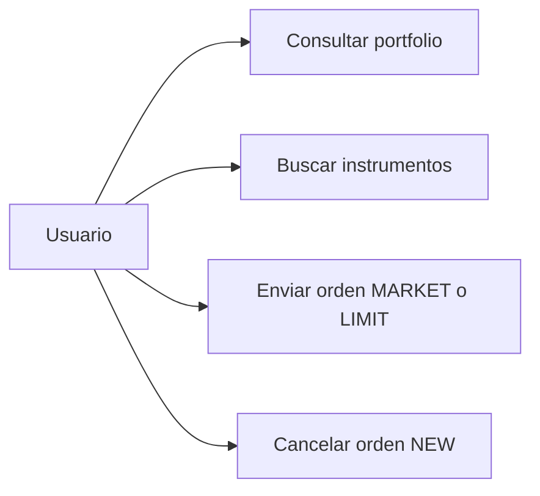
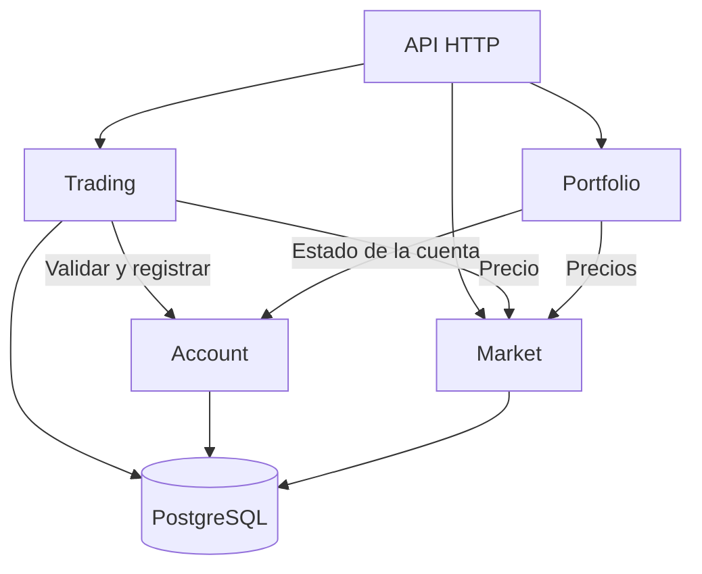
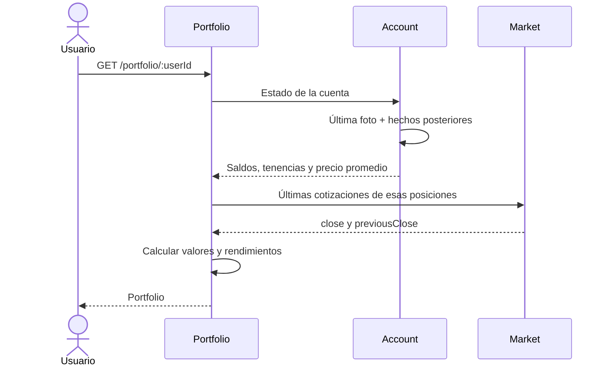
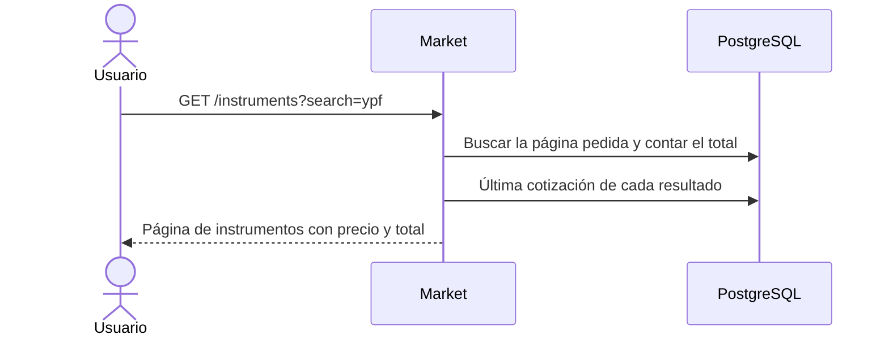
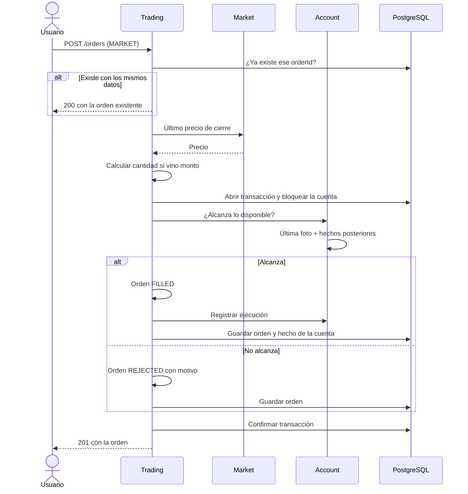
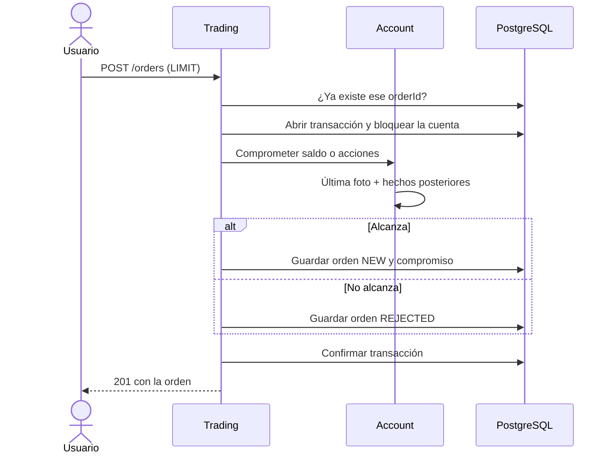
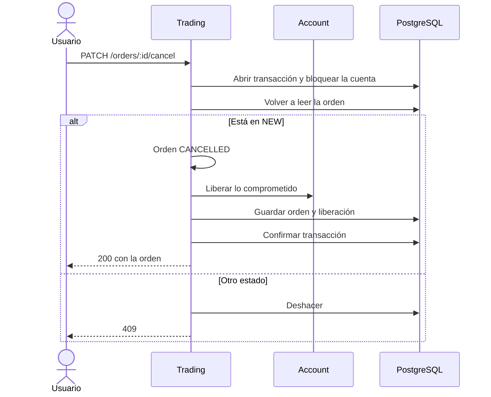
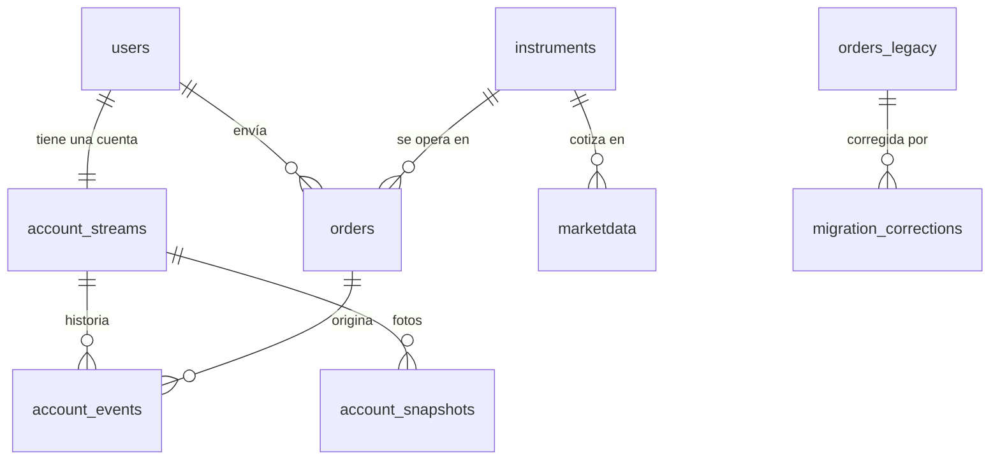

# ADR-001 — Arquitectura del backend de inversiones

**Estado:** Aceptada. Falta validarla con la implementación y las pruebas.
**Origen:** Spike técnico — Cuentas, órdenes y portfolio.

## Índice

| Sección | Contenido |
|---|---|
| [1. Contexto](#1-contexto) | Qué pide el challenge y qué encontró el Spike. |
| [2. Decisión](#2-decisión) | Las decisiones que tomamos. |
| [3. Alternativas descartadas](#3-alternativas-descartadas) | Qué evaluamos y por qué no. |
| [4. Consecuencias](#4-consecuencias) | A favor, en contra y riesgo asumido. |
| [5. Módulos](#5-módulos) | Qué hace cada módulo y cómo se comunican. |
| [6. Casos de uso](#6-casos-de-uso) | Request, response, explicación y diagrama de cada uno. |
| [7. Datos y concurrencia](#7-datos-y-concurrencia) | Tablas antes y después, índices, snapshots y bloqueo de la cuenta. |
| [8. Migración](#8-migración) | Cómo importamos los datos existentes. |
| [9. Pruebas y alcance](#9-pruebas-y-alcance) | Qué probamos y qué queda afuera. |
| [10. Cambios posteriores](#10-cambios-posteriores) | Decisiones que se revisaron durante la implementación. |

## 1. Contexto

El challenge pide una API para consultar el portfolio, buscar instrumentos y enviar órdenes MARKET y LIMIT. Hoy todo se calcula desde `orders`, que mezcla compras y ventas con ingresos y retiros de dinero. El Spike encontró tres problemas:

- La orden 11 deja −10 acciones del instrumento 31.
- Las órdenes LIMIT pendientes no comprometen saldo ni acciones, así que se podría usar dos veces la misma plata.
- Cada orden tiene una sola fecha, así que no se puede saber cuándo cambió de estado.

## 2. Decisión

1. **Tecnología:** Node.js con TypeScript, NestJS (sobre Fastify), PostgreSQL y TypeORM (ver [10. Cambios posteriores](#10-cambios-posteriores)). Una sola aplicación dividida en cuatro módulos: **Trading**, **Account**, **Market** y **Portfolio**. La lógica de negocio no depende del framework ni de la base.
2. **Event Sourcing solo en la cuenta, con snapshots.** El saldo total, lo comprometido, lo disponible, las tenencias y el precio promedio de compra se calculan a partir de los hechos guardados (ingresos, retiros, ejecuciones, compromisos y liberaciones), que nunca se modifican. Para no recorrer toda la historia en cada operación, cada 100 hechos (valor configurable) guardamos una foto del estado. Las órdenes siguen en una tabla común.
3. **Las LIMIT pendientes comprometen recursos.** Una compra compromete su importe y una venta compromete las acciones. Si se cancela, se libera. Los "pesos disponibles" del portfolio son el saldo total menos lo comprometido.
4. **Cada operación es una sola transacción, con la cuenta bloqueada** (`SELECT … FOR UPDATE`). La orden y sus efectos en la cuenta se guardan juntos o no se guarda nada.
5. **Reintentos seguros:** el cliente manda un `orderId` (UUIDv7). Si reenvía el mismo id con los mismos datos, devolvemos la orden que ya existe; si cambia los datos, respondemos `409`.
6. **El costo de cada posición se calcula con precio promedio de compra.** Las órdenes MARKET se ejecutan al último precio de cierre.
7. **La orden 11 se importa como `REJECTED`** y el dato original se conserva (ver Consecuencias).

## 3. Alternativas descartadas

| Alternativa | Por qué no |
|---|---|
| Seguir calculando todo desde `orders` | Mezcla órdenes con movimientos de dinero, no contempla lo comprometido y recalcula todo en cada consulta. |
| Guardar los saldos en tablas y actualizarlos | Funciona y es más simple, pero saldo, compromisos, tenencias y precio promedio pasan a ser datos separados que hay que mantener sincronizados. |
| Event Sourcing también en las órdenes | Alcanza con el estado actual y la fecha del último cambio; reconstruir cada orden no suma nada. |
| Control por versión en lugar de bloqueo | Obliga a reintentar y volver a validar; bloquear la cuenta es más directo para este alcance. |
| FIFO en lugar de precio promedio | Obliga a seguir cada compra por separado y no hay una necesidad que lo justifique. |
| Responder `4xx` (por ejemplo, `422`) a una orden rechazada | La orden se crea y queda guardada: devolver un error por algo que se registró es contradictorio. El pedido era válido; el rechazo es el resultado de negocio. Además, muchos clientes HTTP tratan cualquier `4xx` como excepción e ignoran el cuerpo, y un reintento no podría distinguir "ya existe y fue rechazada" de "el pedido está mal". Por eso respondemos `201` con `status: REJECTED` y el motivo: el código HTTP habla del pedido y el `status` habla de la orden. |
| Importar la orden 11 tal cual | Deja una tenencia negativa, sin precio promedio ni valor de mercado que tengan sentido. |

## 4. Consecuencias

**A favor:**
- Hay una sola fuente de verdad para la plata y las acciones; se puede auditar y recalcular.
- Gracias a los snapshots, leer la cuenta no se vuelve más lento a medida que crece la historia.
- No se puede gastar dos veces el mismo saldo, aunque haya varias instancias de la API.
- Un reintento no duplica la orden.

**En contra:**
- Es más complejo que guardar los saldos: hay que reconstruir el estado, versionar los eventos y mantener los snapshots.
- Las operaciones de una misma cuenta se procesan de a una.
- El saldo ya no se calcula leyendo `orders` directamente, como sugiere el README.

**Riesgo asumido: la orden 11.** El README calcula las tenencias sumando todas las órdenes `FILLED`. Con nuestra corrección, el usuario 1 tiene **$707.100 y 20 acciones del instrumento 31**, en lugar de $753.000 y −10. Lo aceptamos porque esa venta no cumple la regla del propio challenge de rechazar ventas sin acciones suficientes. Para compensarlo:

- `orders_legacy` guarda el dato original sin cambios.
- La corrección afecta solo a la orden 11 y queda registrada con su motivo en `migration_corrections`.
- El reporte de conciliación muestra los dos resultados: el original y el corregido.
- Si apareciera una tenencia previa, se quita la corrección y se vuelve a importar.

## 5. Módulos

| Módulo | De qué se ocupa | Qué no hace |
|---|---|---|
| **Trading** | Crear, ejecutar, rechazar y cancelar órdenes. Valida los datos del pedido y las transiciones de estado (`NEW` → `FILLED` / `CANCELLED`). | No calcula saldos. |
| **Account** | Cuidar el saldo, lo comprometido, las tenencias y el precio promedio. Decide si alcanzan los recursos y registra los hechos de la cuenta. | No ejecuta órdenes. |
| **Market** | Buscar instrumentos y dar la última cotización de cada uno. | No toca la cuenta. |
| **Portfolio** | Juntar el estado de la cuenta con los precios para calcular valores y rendimientos. | No modifica nada; solo lee. |

Los casos de uso coordinan y cada módulo aplica sus reglas. Se comunican con llamadas internas (sin HTTP entre ellos), y ningún objeto de negocio depende de NestJS ni del ORM.





## 6. Casos de uso

**Convenciones de la API:**
- Los importes viajan como texto con decimales (`"707100.00"`), para no perder precisión. Las cantidades de acciones son enteros.
- Los errores tienen siempre la misma forma:

```json
{ "error": { "code": "ORDER_NOT_CANCELLABLE", "message": "Solo se pueden cancelar órdenes en estado NEW." } }
```

- `400` pedido inválido · `404` no existe · `409` conflicto · `5xx` error técnico.
- Una orden rechazada por falta de saldo o de acciones **no es un error de la API**: se guarda y se devuelve con estado `REJECTED`.
- El contrato se publica en OpenAPI (Swagger) y hay una colección de ejemplos para probarla.

> Los tickers y precios de los ejemplos son ilustrativos. Los saldos, cantidades y precios promedio corresponden al usuario 1 después de la migración.

### 6.1 Consultar el portfolio

Devuelve cuánto vale la cuenta, cuánta plata tiene el usuario (total, comprometida y disponible para operar) y cada posición con su cantidad, su valor y su rendimiento.

- **Valor de una posición:** cantidad de acciones por el último precio de cierre.
- **Rendimiento total:** compara ese valor con lo que costaron las acciones que quedan (cantidad por precio promedio de compra).
- **Rendimiento del día:** compara el último cierre con el del día anterior.
- **Valor total de la cuenta:** el saldo total más el valor de todas las posiciones. Lo comprometido no se resta, porque sigue siendo plata del usuario.
- Si a algún instrumento le falta cotización, esa posición va sin valor, `valuationComplete` es `false` y `totalValue` es `null`. No inventamos precios.

**Request**

```http
GET /portfolio/1
```

**Response `200`**

```json
{
  "userId": 1,
  "accountNumber": "10001",
  "totalValue": "905700.00",
  "valuationComplete": true,
  "balance": {
    "total": "707100.00",
    "reserved": "125500.00",
    "available": "581600.00"
  },
  "positions": [
    {
      "instrumentId": 47,
      "ticker": "PAMP",
      "name": "Pampa Holding S.A.",
      "quantity": 40,
      "averagePrice": "930.00",
      "lastPrice": "950.00",
      "marketValue": "38000.00",
      "totalReturnPct": "2.15",
      "dailyReturnPct": "1.06"
    },
    {
      "instrumentId": 54,
      "ticker": "METR",
      "name": "MetroGAS S.A.",
      "quantity": 500,
      "averagePrice": "250.00",
      "lastPrice": "260.00",
      "marketValue": "130000.00",
      "totalReturnPct": "4.00",
      "dailyReturnPct": "1.96"
    },
    {
      "instrumentId": 31,
      "ticker": "TECO2",
      "name": "Telecom",
      "quantity": 20,
      "averagePrice": "1540.00",
      "lastPrice": "1530.00",
      "marketValue": "30600.00",
      "totalReturnPct": "-0.65",
      "dailyReturnPct": "-0.65"
    }
  ]
}
```

**Errores:** `404` si el usuario no existe.



### 6.2 Buscar instrumentos

Busca por ticker o por nombre, sin distinguir mayúsculas y aceptando coincidencias parciales. Devuelve la última cotización de cada resultado. Los pesos (instrumento `MONEDA`) no aparecen en la búsqueda, porque se muestran como saldo.

Como una búsqueda parcial puede traer muchos resultados, la respuesta está **paginada por `limit` y `offset`**:

- `limit`: resultados por página, de 1 a 50. Por defecto, 20.
- `offset`: cuántos resultados saltear. Por defecto, 0.
- Los resultados se ordenan por ticker (y por id si coinciden), así las páginas no se superponen ni saltean resultados.
- La respuesta incluye `total`, la cantidad de coincidencias en todas las páginas, para que el cliente sepa cuántas páginas hay.

Elegimos `limit`/`offset` y no paginación por cursor porque el catálogo de instrumentos es chico y casi no cambia: con pocos cambios, el riesgo de que una página se corra (el problema que resuelve el cursor) es bajo, y `offset` permite saltar a cualquier página. Si el catálogo creciera mucho o cambiara seguido, convendría pasar a cursor.

**Request**

```http
GET /instruments?search=ypf&limit=20&offset=0
```

**Response `200`**

```json
{
  "items": [
    {
      "id": 12,
      "ticker": "YPFD",
      "name": "YPF S.A.",
      "type": "ACCIONES",
      "lastPrice": "18500.00",
      "previousClose": "18200.00",
      "dailyReturnPct": "1.65"
    }
  ],
  "total": 1,
  "limit": 20,
  "offset": 0
}
```

Si no hay coincidencias, devuelve `items` vacío y `total` 0. **Errores:** `400` si falta `search` o viene vacío (`INVALID_SEARCH`), o si `limit` no está entre 1 y 50 u `offset` es negativo (`INVALID_PAGE`).



### 6.3 Enviar una orden MARKET

Se ejecuta en el momento al último precio de cierre. El usuario puede pedir una cantidad de acciones (`size`) o un monto en pesos (`amount`), pero no las dos cosas. Si manda un monto, la cantidad es el monto dividido el precio, redondeado hacia abajo.

- **Compra:** alcanza si la cantidad por el precio no supera lo disponible para operar.
- **Venta:** alcanza si las acciones disponibles (las que tiene menos las comprometidas en ventas LIMIT pendientes) cubren la cantidad.
- Si alcanza, la orden queda `FILLED` y se registra la ejecución en la cuenta. Si no, queda `REJECTED` y la cuenta no se toca.

**Request: compra por cantidad**

```http
POST /orders
Content-Type: application/json

{
  "orderId": "01934f7a-2b6c-7d2e-9a10-5c3e8f7b1a42",
  "userId": 1,
  "instrumentId": 47,
  "side": "BUY",
  "type": "MARKET",
  "size": 10
}
```

**Request: compra por monto** (con un cierre de $950, `floor(10000 / 950) = 10` acciones)

```json
{
  "orderId": "01934f7a-3c1d-7e4f-8b20-6d4f9a8c2b53",
  "userId": 1,
  "instrumentId": 47,
  "side": "BUY",
  "type": "MARKET",
  "amount": "10000.00"
}
```

**Response `201`: ejecutada**

```json
{
  "id": "01934f7a-2b6c-7d2e-9a10-5c3e8f7b1a42",
  "userId": 1,
  "instrumentId": 47,
  "side": "BUY",
  "type": "MARKET",
  "size": 10,
  "price": "950.00",
  "status": "FILLED",
  "rejectionReason": null,
  "createdAt": "2026-11-10T14:00:00.000Z",
  "updatedAt": "2026-11-10T14:00:00.000Z"
}
```

**Response `201`: rechazada** (por ejemplo, venta de 100 acciones teniendo 40)

```json
{
  "id": "01934f7a-4d2e-7f50-9c31-7e5a0b9d3c64",
  "userId": 1,
  "instrumentId": 47,
  "side": "SELL",
  "type": "MARKET",
  "size": 100,
  "price": "950.00",
  "status": "REJECTED",
  "rejectionReason": "INSUFFICIENT_SHARES",
  "createdAt": "2026-11-10T14:05:00.000Z",
  "updatedAt": "2026-11-10T14:05:00.000Z"
}
```

Los motivos de rechazo posibles son `INSUFFICIENT_FUNDS` (no alcanza la plata) e `INSUFFICIENT_SHARES` (no alcanzan las acciones).

**Reintentos:** si llega el mismo `orderId` con los mismos datos, devolvemos `200` con la orden que ya existe y no se ejecuta de nuevo. Si llega con datos distintos, `409`.

**Errores:**
- `400` si faltan campos, se mandan `size` y `amount` juntos, la cantidad no es un entero positivo, el monto da cero acciones o se manda `price` en una MARKET.
- `404` si no existe el usuario o el instrumento.
- `409` si el `orderId` ya se usó con otros datos.
- `409` (`PRICE_UNAVAILABLE`) si el instrumento no tiene cotización: sin último cierre no hay precio al cual ejecutar, y la orden no se guarda. Pasa con IRCP y PGR en los datos del challenge.
- `5xx` si hay un error técnico: se deshace todo y la orden no queda guardada.



### 6.4 Enviar una orden LIMIT

Queda pendiente (`NEW`) al precio que indica el usuario. Mientras está pendiente, compromete lo necesario: una compra compromete cantidad por precio límite y una venta compromete las acciones. Lo comprometido deja de estar disponible para otras órdenes, pero no baja el saldo total ni el valor de la cuenta. Si no alcanzan los recursos, queda `REJECTED`. La ejecución posterior de las LIMIT queda fuera de esta entrega.

Si viene un monto, la cantidad se calcula con el precio límite.

**Request**

```http
POST /orders
Content-Type: application/json

{
  "orderId": "01934f7b-1a2b-7c3d-8e40-1f2a3b4c5d6e",
  "userId": 1,
  "instrumentId": 54,
  "side": "BUY",
  "type": "LIMIT",
  "size": 10,
  "price": "240.00"
}
```

**Response `201`**

```json
{
  "id": "01934f7b-1a2b-7c3d-8e40-1f2a3b4c5d6e",
  "userId": 1,
  "instrumentId": 54,
  "side": "BUY",
  "type": "LIMIT",
  "size": 10,
  "price": "240.00",
  "status": "NEW",
  "rejectionReason": null,
  "createdAt": "2026-11-10T14:10:00.000Z",
  "updatedAt": "2026-11-10T14:10:00.000Z"
}
```

Después de esta orden, el portfolio muestra `reserved` $2.400 más alto y `available` $2.400 más bajo; `total` no cambia.

**Errores:** los mismos que en MARKET, más `400` si falta `price` o no es mayor a cero.



### 6.5 Cancelar una orden

Solo se pueden cancelar órdenes en `NEW`. Al cancelar, la orden pasa a `CANCELLED` y se libera lo que tenía comprometido, todo en la misma transacción. La orden se vuelve a leer con la cuenta bloqueada, para que no se pueda cancelar dos veces.

**Request**

```http
PATCH /orders/01934f7b-1a2b-7c3d-8e40-1f2a3b4c5d6e/cancel
```

**Response `200`**

```json
{
  "id": "01934f7b-1a2b-7c3d-8e40-1f2a3b4c5d6e",
  "userId": 1,
  "instrumentId": 54,
  "side": "BUY",
  "type": "LIMIT",
  "size": 10,
  "price": "240.00",
  "status": "CANCELLED",
  "rejectionReason": null,
  "createdAt": "2026-11-10T14:10:00.000Z",
  "updatedAt": "2026-11-10T14:20:00.000Z"
}
```

**Errores:** `404` si la orden no existe; `409` si no está en `NEW` (ya ejecutada, rechazada o cancelada).



## 7. Datos y concurrencia

### Tablas: antes y después

El README permite modificar y agregar tablas si se justifica. Respetamos la convención de nombres que ya tiene la base (columnas en camelCase, como `instrumentId` o `previousClose`).

| Tabla actual | Qué pasa | Por qué |
|---|---|---|
| `users` | **Sin cambios.** | Ya identifica la cuenta (`id`) y su número (`accountNumber`). |
| `instruments` | **Sin cambios en columnas.** Se agrega un índice para la búsqueda. | La búsqueda por ticker o nombre la necesita. |
| `marketdata` | **Sin cambios en columnas.** Se agrega un índice para encontrar la última cotización. | El portfolio y las órdenes MARKET piden siempre el último precio. |
| `orders` | **Se modifica.** | Necesitamos id generado por el cliente, dos fechas, motivo de rechazo y detección de reintentos. Los ingresos y retiros ya no se crean acá. |
| — | **Nuevas:** `orders_legacy`, `migration_corrections`, `account_streams`, `account_events`, `account_snapshots`. | Conservar el origen, registrar correcciones y guardar la cuenta con Event Sourcing. |

#### `orders`: columna por columna

| Antes | Después | Cambio |
|---|---|---|
| `id` (entero autoincremental) | `id` (UUID) | Lo manda el cliente (UUIDv7) y sirve para detectar reintentos. Las órdenes migradas reciben un UUID fijo. |
| — | `legacyOrderId` (entero, único, opcional) | El id original de las órdenes migradas, para poder conciliar. |
| `instrumentId`, `userId` | `instrumentId`, `userId` | Sin cambios. |
| `side` (`BUY`, `SELL`, `CASH_IN`, `CASH_OUT`) | `side` (`BUY`, `SELL`, `CASH_IN`, `CASH_OUT`) | Se mantienen los valores. Las órdenes nuevas son solo `BUY` y `SELL`; los ingresos y retiros históricos quedan importados y además se registran como hechos de la cuenta. |
| `size`, `price`, `type`, `status` | `size`, `price`, `type`, `status` | Sin cambios de significado. `price` pasa a `NUMERIC` si no lo era. |
| `datetime` | `createdAt` y `updatedAt` | Separa cuándo se creó la orden de su última modificación. En las históricas, las dos valen el `datetime` original. |
| — | `rejectionReason` (opcional) | `INSUFFICIENT_FUNDS` o `INSUFFICIENT_SHARES`. |
| — | `requestHash` | Huella del pedido: si llega el mismo `orderId` con otros datos, respondemos `409`. |

#### Tablas nuevas

| Tabla | Columnas | Para qué sirve |
|---|---|---|
| `orders_legacy` | Las mismas que el `orders` original. | Copia intacta de los datos recibidos. No se modifica nunca. |
| `migration_corrections` | `id`, `legacyOrderId`, `field`, `originalValue`, `correctedValue`, `reason`, `appliedAt` | Registra cada corrección de la migración. Hoy hay una sola: la orden 11, `status` de `FILLED` a `REJECTED`. |
| `account_streams` | `userId` (clave), `version` | Una fila por usuario con el número de versión de su historia. Es la fila que se bloquea al operar; no guarda saldo. |
| `account_events` | `id`, `userId`, `version`, `type`, `payload`, `orderId` (opcional), `occurredAt` | Los hechos de cada cuenta, numerados en orden: ingreso, retiro, ejecución de compra o venta, compromiso de saldo, compromiso de acciones y liberación. `payload` guarda lo necesario para recalcular (instrumento, cantidad, precio, importe). |
| `account_snapshots` | `userId`, `version`, `state`, `createdAt` | La foto del estado de la cuenta (saldo, comprometido, tenencias y precio promedio) en una versión dada. Se genera una al migrar y después una cada 100 hechos. Se puede borrar y regenerar; nunca reemplaza a los hechos. |

#### Índices y restricciones

| Dónde | Qué | Para qué |
|---|---|---|
| `account_events` | Único por (`userId`, `version`) | Que dos hechos no puedan ocupar el mismo lugar en la historia de una cuenta. |
| `account_snapshots` | Clave (`userId`, `version`) | Encontrar rápido la última foto de cada cuenta. |
| `orders` | Único en `legacyOrderId` | Que la migración se pueda repetir sin duplicar. |
| `orders` | (`userId`, `status`) | Buscar las órdenes pendientes de un usuario. |
| `marketdata` | (`instrumentId`, fecha descendente) | Obtener la última cotización sin recorrer toda la tabla. |
| `instruments` | Sobre `ticker` y `name` en minúsculas | Búsqueda parcial sin distinguir mayúsculas. Con 66 instrumentos no hace diferencia, pero acompaña el crecimiento. |



Suponemos una cuenta por usuario (`users.id`). Los importes se guardan con decimales exactos (`NUMERIC`) y las cantidades de acciones son siempre enteras. El precio promedio se guarda con precisión completa y solo se redondea al mostrarlo.

### Cómo se lee la cuenta

Se busca la última foto, se aplican en orden los hechos posteriores a esa versión y se obtiene el estado actual. Si no hay foto, se recorre todo desde el principio. Cuando desde la última foto se acumularon 100 hechos nuevos, se guarda una nueva dentro de la misma transacción.

### Operaciones simultáneas

Toda operación que modifica la cuenta bloquea su fila en `account_streams` antes de leer el estado. Si llegan dos órdenes a la vez, la segunda espera a que la primera termine y valida con el saldo ya actualizado. *Ejemplo:* con $100.000 disponibles llegan dos compras de $80.000: la primera se ejecuta y la segunda ve $20.000 y queda `REJECTED`. Un error técnico (como agotar el tiempo de espera) deshace todo y responde `5xx`; nunca se convierte en un rechazo por falta de saldo.

## 8. Migración

1. Copiar `orders` a `orders_legacy`.
2. Importar las órdenes por fecha (y por id si coinciden), convirtiendo los ingresos, los retiros y las ejecuciones en hechos de la cuenta y aplicando la corrección de la orden 11.
3. Comprometer el saldo de las LIMIT pendientes (órdenes 5 y 7). Si no alcanzan los recursos, la migración se frena y avisa.
4. Usar la fecha original como fecha de creación y de última modificación de las órdenes históricas. No se inventan cambios de estado.
5. Generar la foto inicial de cada cuenta.

La migración se puede correr varias veces sin duplicar nada.

**Resultado esperado para el usuario 1:** saldo total $707.100, comprometido $125.500 y disponible $581.600; 40 acciones del instrumento 47, 500 del 54 y 20 del 31 (precio promedio $1.540).

## 9. Pruebas y alcance

Usamos Jest y Supertest contra un PostgreSQL real. Cubrimos:
- Órdenes MARKET y LIMIT, por cantidad y por monto.
- Rechazo por falta de saldo y por falta de acciones.
- Cancelación y liberación de lo comprometido.
- Reintento con el mismo `orderId`, con los mismos datos y con datos distintos.
- Dos compras simultáneas contra el mismo saldo.
- Que un error técnico deshaga todo.
- Que recorrer todos los hechos dé el resultado esperado de la migración.
- Que la última foto más los hechos posteriores dé lo mismo que recorrer todo desde el principio.

**Fuera de alcance:** autenticación (en un producto real habría que verificar que el `userId` es del usuario logueado), ejecución posterior de las LIMIT y comisiones.

## 10. Cambios posteriores

### Prisma → TypeORM

La primera implementación usó Prisma 7. Se reemplazó por **TypeORM 1**, el ORM más usado con NestJS. El cambio queda acotado a la infraestructura: dominio, casos de uso, puertos y API no cambiaron, y las mismas pruebas (unitarias e integración) pasan sin tocar ningún resultado esperado.

- **Mapeo:** `EntitySchema` por módulo (`infrastructure/persistence/schemas/`) sobre interfaces planas de filas; el dominio no lleva decoradores del ORM.
- **Esquema:** solo con migraciones (`src/database/migrations/`), con `synchronize` apagado. Son las mismas tres de antes (línea de base, Event Sourcing de la cuenta y versión de esquema de los hechos). Cada una detecta si ya estaba aplicada, así que una base migrada con Prisma pasa a TypeORM sin perder datos: solo se registran en la tabla `migrations`.
- **Transacciones:** `TypeOrmUnitOfWork` usa `DataSource.transaction` con `lock_timeout` y `statement_timeout` locales; el bloqueo de la cuenta es `pessimistic_write` (`SELECT … FOR UPDATE`).
- **Tipos:** `NUMERIC` y `BIGINT` se leen como texto y las fechas sin zona como UTC, para no perder precisión ni depender de la zona horaria del servidor.
- **Costo:** el cliente de Prisma estaba tipado a partir del schema; con TypeORM, las filas son interfaces que hay que mantener alineadas con las migraciones. Las pruebas de integración contra PostgreSQL real cubren esa diferencia.
